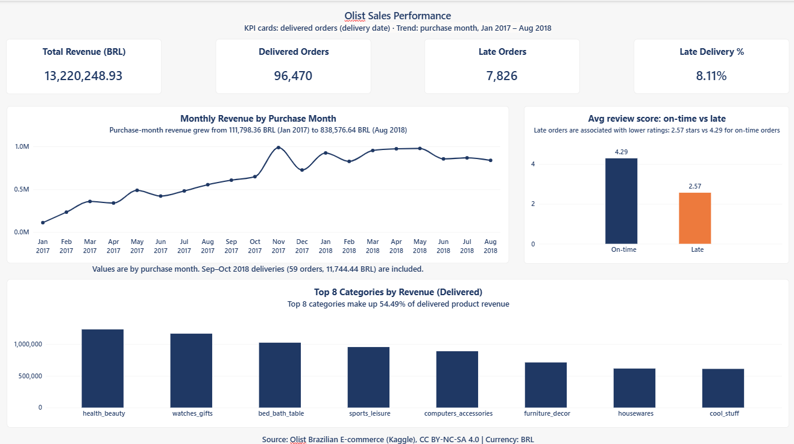

# Olist E-Commerce Sales Analysis

## Business problem

An e-commerce marketplace wants to answer three questions:

1. Why are customer ratings low?
2. Where does the revenue come from?
3. Do customers come back to buy again?

## Dataset

- Olist Brazilian marketplace data: 99,441 orders across 9 tables.
- Source: https://www.kaggle.com/datasets/olistbr/brazilian-ecommerce
- The raw CSV files are not included in this repository.

## Tools

- **SQL Server (SSMS):** data quality checks and business analysis
- **Excel:** validation of query results
- **Power BI:** dashboard (1 page built)

## Approach

1. **Data quality checks:** row counts first, then 7 checks on nulls, duplicates, impossible dates, orphan keys, value ranges, and category mapping.
2. **Analysis:** 8 business queries covering revenue, categories, ratings, delivery performance, and customer retention.
3. **Excel validation:** 5 SQL results re-checked in Excel (totals, percentages, and shares). One figure, January 2017 revenue, was recalculated from the raw CSV files. Both methods give **111,798.36 BRL**.
4. **Dashboard:** Power BI page with KPI cards, a monthly revenue trend, a rating comparison, and top categories.

## Key findings

### 1. Late delivery is linked to lower ratings

- Late orders average **2.57 stars**. On-time orders average **4.29 stars**. That is a **40% drop**.
- Late orders are **8% of delivered orders**, but they account for **38% of all 1-star reviews** on delivered orders.
- The 1-star rate is **46%** for late orders, compared with **7%** for on-time orders.
- Low reviews (1–2 stars) are **54%** for late orders, compared with **9%** for on-time orders.
- This is an association in observational data. It is not proof that late delivery causes low ratings.

### 2. Promise padding

- Customers are promised about **24 days** on average.
- Orders arrive in about **12 days** on average: **12.00 days per order** (Q5). Q1 shows **12.41 days per item**, because Q1 counts each item row, so orders with more items weigh more.
- The high on-time rate reflects generous promised dates, not only fast logistics.

### 3. Retention is very low

- **97%** of customers placed only one order (**90,549** customers).
- Only **3%** (**2,801** customers) came back for another order.
- The customer base is **93,350**. Customers are counted by `customer_unique_id`, because `customer_id` changes with every order.

### 4. Revenue is concentrated

- The top category, **health_beauty**, makes up **9.33%** of product revenue (1,233,131.72 BRL).
- The **top 8 categories** make up **54.5%** of product revenue.

### 5. The trend has incomplete periods

- 2016 has very few orders: September 2016 = 4, October 2016 = 324, November 2016 = missing, December 2016 = 1.
- The monthly trend therefore starts in **January 2017**.
- The monthly trend ends in **August 2018**. No delivered order with a delivery date appears after August 2018 in this data.

## Metric definitions

- **Sales / revenue:** sum of `order_items.price` for **delivered** orders only, with a delivery date. Freight is excluded. Total product revenue is **13,220,248.93 BRL**. Freight is **2,198,145.90 BRL** and is analysed separately.
- **Late order:** `order_delivered_customer_date` is later than `order_estimated_delivery_date`, and the order status is delivered.
- **Late delivery %:** late orders ÷ delivered orders.
- **Customer:** `customer_unique_id`.
- **Average order value (AOV):** product revenue ÷ distinct delivered orders. AOV is **137.04 BRL**.

## Data quality notes

- **Duplicate review IDs:** 789 duplicate review IDs exist in the source. Reviews are handled at order level.
- **No review:** 646 delivered orders have no review. The rating analysis uses an INNER JOIN, so these orders are excluded.
- **Delivered but no delivery date:** 8 orders have status `delivered` but no customer delivery date. They are excluded from revenue and customer counts, which removes 1,249.18 BRL and 8 customers.
- **Missing category:** 623 products (1.9%) have no category name or no English translation. They are kept with a LEFT JOIN, so their category name is blank (NULL) in the results.
- **Impossible dates:** 166 orders (0.17%) have a carrier shipping date earlier than the purchase date. No order has a customer delivery date earlier than its purchase date. The 166 orders are flagged, not deleted.
- **2016 data:** incomplete, so it is excluded from the monthly trend.

### Reconciling the totals

Different queries show different row totals, and this is expected:

- Q5 counts **96,470** delivered orders (with a delivery date).
- Q6 counts **96,353** review rows for those orders.
- 96,470 − 646 (no review) = 95,824
- 95,824 + 529 (duplicate review rows) = **96,353**

Late share also has two bases:

- **7.99%** = 7,700 late of 96,353 reviewed delivered orders (used in the rating finding).
- **8.11%** = 7,826 late of 96,470 delivered orders (used on the dashboard).

The difference does not change the 40% rating finding.

## Repository structure

```
olist-ecommerce-analysis/
├── sql/
│   ├── 00_verify_import_and_quality.sql   -- row counts + 7 data quality checks
│   └── 02_analysis_queries.sql            -- 8 business queries
├── outputs/
│   ├── day2_data_quality_results.xlsx     -- data quality results
│   ├── day2_analysis_results.xlsx         -- analysis results (Excel validation)
│   └── findings_summary.md                -- findings write-up
├── powerbi/
│   ├── olist_dashboard.pbix               -- Power BI file
│   └── olist_theme.json                   -- dashboard theme
├── images/
│   └── dashboard.png                      -- dashboard screenshot
├── .gitignore
└── README.md
```

## How to run

1. Import the Olist CSV files into a SQL Server database named `ecommerce`.
2. Run the SQL files in SSMS in this order:
   - `00_verify_import_and_quality.sql`
   - `02_analysis_queries.sql`
3. Each file is split into batches with `GO`. Run each file as a whole.

## Dashboard

Power BI dashboard, **1 page built**:

- **KPI cards:** Total Revenue (13,220,248.93 BRL), Delivered Orders (96,470), Late Orders (7,826), Late Delivery % (8.11%)
- **Monthly revenue trend:** January 2017 to August 2018
- **Average review score:** on-time vs late
- **Top 8 categories** by revenue

Planned, not yet built: Delivery & Experience, Products & Customers.



## Notes from the build

These are mistakes I made and fixed. They are listed here so the process is clear.

- **`review_score` is TINYINT.** `AVG()` returned whole numbers. Fixed by casting inside `AVG()`.
- **`RowCount` is a reserved keyword** in SQL Server and caused a syntax error. Renamed to `TotalRows`.
- **`MoM_Pct` overflowed** `DECIMAL(6,2)` in the first months (values above 1,000,000%). Widened to `DECIMAL(18,2)`.
- **Partial months distort trends.** September 2016 has 4 orders, October 2016 has 324, November 2016 has none, and December 2016 has 1. The 2016 months are too thin, so month-over-month change is meaningless. The trend starts in January 2017.
- **Power BI date type cut the time part.** `order_delivered_customer_date` was loaded as Date. Same-day late deliveries were marked as on time, and the late count was 6,534 instead of 7,826. Changing the column to Date/Time fixed it.
- **Totals did not match at first** (96,470 vs 96,353). Reconciled using the missing-review count and the duplicate review rows.
- **Revenue did not match Power BI** (13,181,027.13 vs 13,179,777.95 for 2017–2018). Traced to 8 delivered orders with no delivery date. Adding the delivery-date filter to the monthly query fixed the match. The month-by-month order counts drop by 8 in total after the filter, which matches the 8 orders.

## Limitations

- The data covers marketplace orders only. Seller-side costs and margins are not included.
- Ratings are a proxy for satisfaction. Not every customer leaves a review.
- The rating finding is an association, not causation.
